# Beacon Message Flow Walkthrough

This walkthrough traces the supplied source code. The demos were not
executed. Message delivery below assumes registration has completed and
the message is not lost, rejected, or overwritten before reception.

## In-process delivery

In `demo/src/inproc_demo.adb`, Main registers `Temp_Sub` as a Best_Effort
subscriber, then releases the Sensor task through `Sensor.Go`. Sensor
creates its publisher and constructs its first Reading:
`(Sensor => 1, Sequence => 1, Temperature => 21.0)`.

Sensor calls `Temperature_Topic.Publish`. In `src/beacon-topic.adb`,
Publish visits subscribers in registration order and calls each protected
`Queue.Push`. The temperature topic has a queue depth of 32, defined in
`demo/src/telemetry.ads`.

Push delegates storage to `Beacon.Queue`. In `src/beacon-queue.adb`,
`Ring.Push` writes at Tail, advances Tail modulo queue depth, and
increments Fill. A full Best_Effort queue replaces its oldest message and
increments its drop counter. A full Reliable queue instead blocks Publish
until space becomes available, delaying subscribers later in the loop.

Main calls `Temperature_Topic.Try_Receive`. This calls protected
`Try_Pop`, then `Ring.Pop` when nonempty. Pop returns the oldest value,
advances Head, and decreases Fill. Main uses the returned Reading only
when Got is True. The message remains typed throughout this path.

## UDP delivery

In `demo/src/net_publisher.adb`, the application opens UDP multicast
(default group 239.255.0.1, port 5000), starts a Best_Effort egress bridge,
and publishes Readings such as `(Sensor => 7, Sequence => 1,
Temperature => 0.1)`.

In `src/net/beacon-bridge.adb`, Egress_Task retrieves a Reading from its
local subscriber queue. `Serialize_Reading`, in
`demo/src/telemetry-codecs.adb`, uses the record representation to place
the Reading into nine payload bytes. `Wire.Encode`, in
`src/net/beacon-wire.adb`, adds the header fields and CRC-32 checksum.
The bridge frame sequence is separate from Reading.Sequence.

`UDP.Send`, in `src/net/beacon-transport-udp.adb`, calls Send_Socket to
transmit the frame as a datagram. In the receiving process, Ingress_Task
calls UDP.Receive with a 0.1-second socket-readiness timeout. Wire.Decode
checks frame size, magic, declared length, and checksum. Ingress checks
the topic ID, tracks sequence discontinuities, and deserializes valid
payloads back into Readings.

Ingress calls local Try_Publish. In `demo/src/net_subscriber.adb`, the
application retrieves a queued Reading through Try_Receive and updates
its receive count and last payload sequence.

## Diagram

```mermaid
flowchart TD
    subgraph Local["In-process delivery"]
        A["Sensor publishes Reading"] --> B["Topic calls protected Push"]
        B --> C["Subscriber ring buffer"]
        C --> D["Main calls Try_Receive"]
    end
    subgraph Network["UDP delivery between processes"]
        E["Sender publishes Reading"] --> F["Egress subscriber queue"]
        F --> G["Serialize and Wire.Encode"]
        G --> H["UDP Send_Socket"]
        H --> I["UDP Receive_Socket"]
        I --> J["Decode and deserialize"]
        J --> K["Local Try_Publish"]
        K --> L["Application subscriber queue"]
        L --> M["Application Try_Receive"]
    end
```

## Delivery limitations

Reliable is a local queue policy, not an end-to-end UDP guarantee. Ingress
uses Try_Publish, so a full Reliable queue can refuse a new message.
The returned Accepted value is unused; this refusal is not logged here.
Sequence_Gaps counts discontinuity events, not an exact number of lost
messages. CRC checks corruption but does not recover messages.

Start_Egress can return before its subscriber registration completes,
so early publications may miss the bridge.
